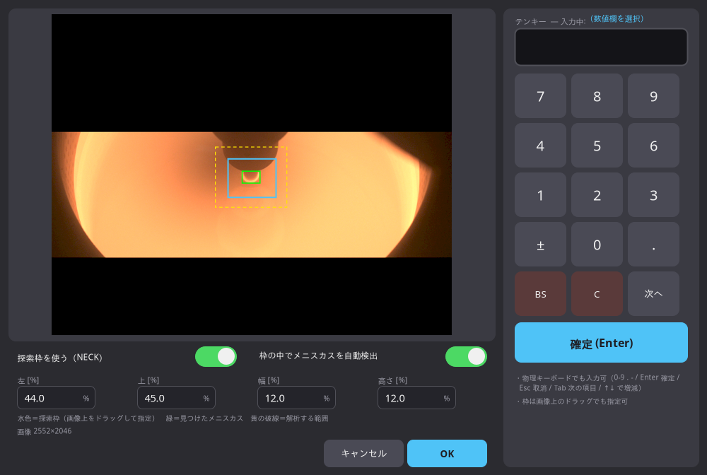
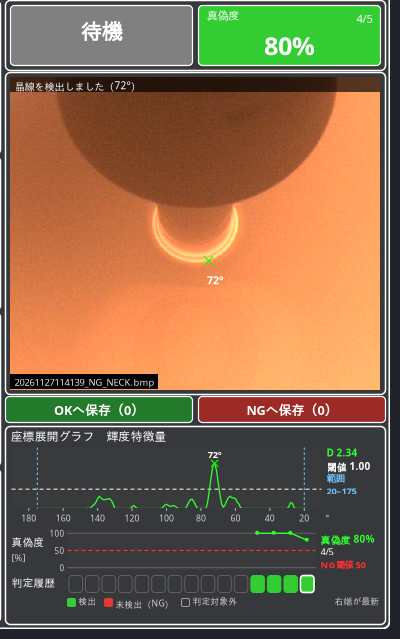

# PullerView V2 — 探索枠とメニスカスの自動検出（2.0.10.0／タグ `V2-v11`）

作成: 2026-11-27

## 1. 背景

XG-X の画像は坩堝全体が写り、メニスカスは画面幅の約 4.5% しかない。画面全体からリングを探すと坩堝の縁を拾い、晶線を誤検出した（2026-11-27 の実機画像 11 枚）。

## 2. 内容

工程ごとに**探索枠**（画像に対する % の矩形）を設定し、その中でメニスカス（細い明るい弧）を自動検出して、周辺だけを切り出して晶線解析・表示する。

- 設定画面「晶線解析設定」タブ → 工程を選ぶ → 右上の「探索枠…」ボタン。
- 枠は画像上のドラッグ、または数値（左・上・幅・高さ [%]）で指定する。ドラッグすると「探索枠を使う」が ON になる。
- 「枠の中でメニスカスを自動検出」を OFF にすると、枠そのものを解析する。
- 自動検出で見つからないときは枠そのものを解析し、画像の上に「探索枠の中にメニスカスが見つかりません」と出す。
- 探索枠を使うとき、右欄の解析画像は切り出した範囲を表示する。





## 3. 設定（VisionView.ini の各工程）

```
[NECK]
search_frame=1            ; 1=探索枠を使う（既定 0）
search_rect=44,45,12,12   ; 左,上,幅,高さ [%]
search_auto=1             ; 1=枠の中で自動検出／0=枠そのものを解析
```

既定は全工程 `search_frame=0`（従来どおり画面全体）。XG-X では工程ごとに設定が必要。

## 4. 確認したこと（サンドボックス、実機画像 11 枚、NECK、枠 44,45,12,12）

| 画像 | 枚数 | 結果 |
|---|---|---|
| 原画 5104×4092 | 2 | メニスカスを検出、リング当てはめ成功、突起 1 本（52°／114°） |
| 1/2 2552×2046 | 7 | 同上。突起 102→92→82→72→61→50→53° |
| 1/4 1276×1023 | 2 | メニスカスは検出するが、リング当てはめは 1 枚が異常値、1 枚が未検出 |

- 前提の画像サイズは 1/2（2552×2046）。1/4 は現行の解析では使えない。
- 設定の読込（枠をメニスカスから外すと未検出になること）、設定画面・右欄の描画（日本語・中国語）。

## 5. 未確認・制約

- 設定画面のドラッグ・クリック操作（コンパイルのみ）、Windows 実機、VS2022 でのビルド。
- 自動検出の条件（明るさの差 6、弧の大きさ）は今回の XG-X NECK 画像 11 枚に合わせた値。旧 CV5701 の NECK 画像では見つからない例があった。CROWN 以降の XG-X 画像では未検証。
- 突起の特徴量は 1.1〜2.5 で閾値 1.0 に近い。検出は 1 本だけで、NG（突起が消えた）画像での検証は未実施。
- 探索枠を使うと、解析前に全体画像の縮小表示も作るため、1 枚あたりの処理時間が増える（実機での時間は未測定）。
