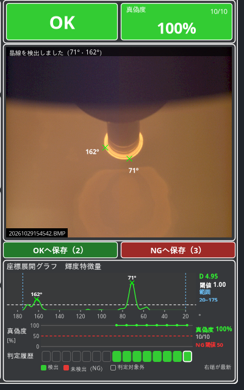
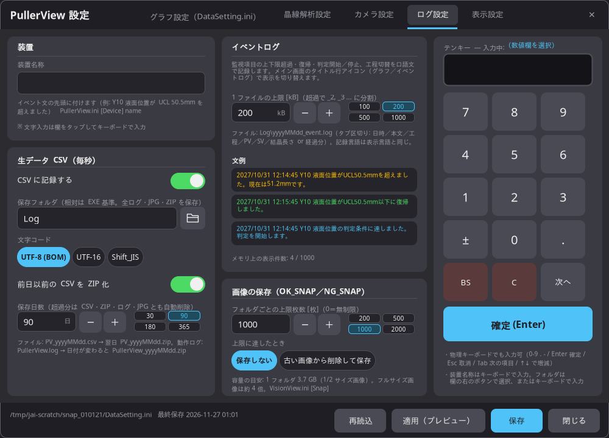

# PullerView V2 — 画像の保存 OK_SNAP／NG_SNAP（2.0.9.0／タグ `V2-v10`）

作成: 2026-11-27（V2-v8 の「教示画像の保存」（右クリックメニュー・`NgTeach`・`[Teach]`）を置き換え）

## 1. 内容

通常の受信画像（`[Image]`。最新 `max_files` 枚で自動削除）とは別に、次の画像を残す。**保存するだけで、判定基準（閾値など）は変わらない。**

| 保存先 | きっかけ |
|---|---|
| `NG_SNAP` | 自動: 現在の判定基準で「未検出」と数えた画像（`auto_ng=1`）／手動: 解析画像の下の「NGへ保存」ボタン |
| `OK_SNAP` | 手動: 「OKへ保存」ボタン |



## 2. 自動保存の条件

画像 1 枚ごとに判定し、**判定に数えた画像のうち、あるはずの晶線を検出できなかったもの**を保存する（判定履歴の赤「未検出（NG）」に当たる画像。CROWN などで期待する晶線の一部だけ欠けた画像も含む）。

次の画像は保存しない。

- 判定開始前の待機中の画像
- シールド遮蔽で判定対象外の画像
- 晶線解析の対象外の工程の画像
- 再生フォルダが `NG_SNAP`／`OK_SNAP` のときの再生画像（再生中のフォルダへ同じ画像を書き足し続けるのを防ぐため。ほかのフォルダの再生・模擬カメラでは保存する）

画面全体の判定（真偽度が閾値を下回ったときの NG）とは別の条件である。全体の判定が OK でも、未検出と数えた 1 枚は保存される。

## 3. ボタン

右欄の解析画像の下。対象は**押した時点で表示している画像**。括弧内は各フォルダの枚数。

- 結果はイベントログに出る。保存できなかったとき（上限・書込み失敗・同じ画像を同じフォルダへ 2 回）はメッセージも出る。
- 同じ画像を OK と NG の両方へ保存することはできる。
- 右欄を閉じているとき・最小化・アイコン表示中は押せない。`[Snap] enable=0` でボタンを出さない。

## 4. ファイルと記録

- 画像: `YYYYMMDDHHMMSS_NG_工程.bmp`／`…_OK_工程.bmp`（日時は**画像の時刻**。受信したままの BMP。同名があれば `_NG2_` のように番号を付ける）。
  先頭 14 桁が時刻、末尾が工程なので、ファイル再生（工程の取得元 `filename`）でそのまま使える。
- 記録: 各フォルダの `snap.csv`（UTF-8 BOM、1 保存 1 行）。保存日時、`trigger`（auto／manual）、工程、そのときの判定・真偽度・検出方式・閾値・検出範囲・検出した晶線の角度。

## 5. 設定（VisionView.ini）

```
[Snap]
enable=1
auto_ng=1
ng_folder=NG_SNAP
ok_folder=OK_SNAP
max_files=1000     ; フォルダごとの上限枚数（0=無制限）
on_full=stop       ; stop=保存しない／delete_oldest=古い画像から削除して保存

[Playback]
folder=NG_SNAP     ; ファイル再生の既定フォルダ（V2-v9 で Image\sample から変更）
```

設定画面では「ログ設定」タブの「画像の保存（OK_SNAP／NG_SNAP）」で、上限枚数と、上限に達したときの動作（保存しない／古い画像から削除して保存）を選べる（V2-v10）。既定の上限は 1000 枚（V2-v9 は 200 枚）。



- 1000 枚の容量の目安: 1/2 サイズ画像で 1 フォルダ約 3.7 GB、フルサイズ画像で約 15 GB。
- 「保存しない」（`on_full=stop`）のまま NG_SNAP が自動保存で上限に達すると、「NGへ保存」ボタンも保存できなくなる（メッセージが出る）。自動保存の分は PullerView.log に 1 回だけ記録する。
- 既にある VisionView.ini の `[Playback] folder` は書き換えない（既定が変わるのは ini に値がない場合と、同梱の `config/VisionView.ini`）。
- V2-v8 の `[Teach]` と `NgTeach` フォルダは使わない（読み込まない）。

## 6. 確認したこと／していないこと

- サンドボックス（Mono）で単体確認: 自動保存の条件（検出・未検出・待機中・`auto_ng=0`・SNAP フォルダ再生中）、手動保存、二重保存の拒否、フォルダごとの上限と `stop`／`delete_oldest`、記録、保存した画像のファイル名から工程を読めること。
- ボタンの描画（日本語・中国語）、ログ設定タブの描画（日本語・英語・中国語）、設定の保存と再読込。
- **未確認**: ボタンと設定画面のクリック操作（コンパイルのみ）、Windows 実機、VS2022 でのビルド、実カメラ受信中の自動保存。
- 自動保存は解析スレッドで行う。フルサイズ画像（約 15 MB）の書込み中は次の画像の解析が待たされる。
