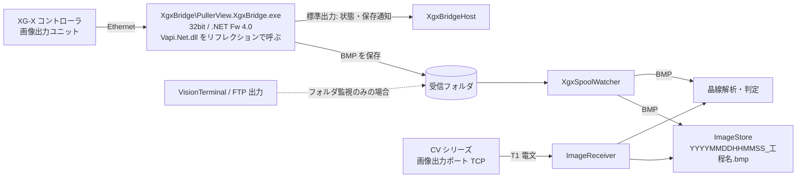

# PullerView V2 — XG-X 画像取り込み（CvImageSaver v1.4.2 からの移植）

2026-11-25。ブランチ `PullerView_V2`、版 2.0.1.0（タグ `V2-v2`）。

CvImageSaver v1.4.2 の「XG-X と Ethernet で接続して画像を取り込む機能」を PullerView V2（.NET Framework 4.0 / x86）へ移植した。
CV シリーズ（CV-5701 等。画像出力ポートへ TCP 接続）は従来どおり使え、設定で機種を切り替える。

## 1. 仕組み



- XG-X の画像は、Vapi.Net.dll（KEYENCE XG-X VisionTerminal 付属）が「受信フォルダ」へ BMP で保存する。画像データを直接受け取る API は無い。
- PullerView は受信フォルダを監視し、書込みが終わった BMP を取り込んで、保存（`[Image]` の設定）と晶線解析へ渡し、受信フォルダから削除する。
- Vapi.Net.dll は別プロセス（XgxBridge）で動かす。Vapi 内部の異常で PullerView 本体が落ちないようにするため。

## 2. 追加・変更したファイル

| ファイル | 内容 |
|---|---|
| `src/PullerView/XgxCore40.cs`（新規） | 通知形式 `XgxBridgeMessage`、設定 `XgxSettings`、受信フォルダ監視 `XgxSpoolWatcher`、ブリッジ起動・監視 `XgxBridgeHost` |
| `src/tools/XgxBridge/`（新規プロジェクト） | `PullerView.XgxBridge.exe`。ビルド後に `PullerView\bin\<構成>\XgxBridge\` へコピーされる |
| `src/tools/XgxBridge/test/FakeVapi.cs`（新規・ビルド対象外） | 試験用の模擬 Vapi.Net.dll のソース |
| `src/PullerView/VisionView.cs` | `[Camera] model`・`[Xgx]` の読み書き、XG-X 入力の開始・停止・状態表示、模擬 XG-X |
| `src/PullerView/CameraSettings.cs` | カメラ設定タブに機種の切替と XG-X の設定（日・英・中） |
| `src/PullerView/CvCore40.cs` | `ImageStore.Save` に保存時刻の指定を追加（XG-X は画像が出力された時刻をファイル名に使う） |
| `src/PullerView/Program.cs` | 診断モード `--xgx-test`／`--camera-test` |
| `config/VisionView.ini` | `[Camera] model`、`[Xgx]` を追加 |

## 3. 設定（VisionView.ini）

| キー | 既定 | 内容 |
|---|---|---|
| `[Camera] model` | `cv` | `cv`＝CV シリーズ／`xgx`＝XG-X |
| `[Xgx] mode` | `bridge` | `bridge`＝直接受信／`folder`＝フォルダ監視のみ |
| `[Xgx] ip` | `192.168.1.20` | XG-X の IP アドレス（直接受信のみ）。ポート番号の設定は無い |
| `[Xgx] spool_folder` | `XgxRecv` | 受信フォルダ（作業用。相対は EXE 基準）。**取り込んだ BMP は削除する** |
| `[Xgx] vapi_folder` | （空） | VisionTerminal のインストール先フォルダ（Vapi.Net.dll、libEGL.dll、libGLESv2.dll などがあるフォルダ） |
| `[Xgx] bridge_exe` | （空） | 空＝`XgxBridge\PullerView.XgxBridge.exe` |
| `[Xgx] stable_ms` / `scan_ms` | 1000 / 500 | 書込み完了とみなす無変化時間／確認間隔 |
| `[Xgx] detailed_log` | 0 | 1＝接続の各段階・取り込み 1 件ごとを PullerView.log に記録 |

再接続間隔は `[Camera] reconnect_sec` を共用する。設定画面では「カメラ設定」タブの左列で設定する。

受信フォルダの制限（守られていないときは監視も削除も行わない）:
- 画像保存フォルダ・再生フォルダと同じ場所、親子関係は不可。
- PullerView.exe のフォルダそのもの、その上位フォルダ、ドライブ直下は不可。
- 直接受信では 100 文字以内（Vapi.Net.dll のパス長の制限）。半角英数字を推奨。

## 4. CvImageSaver v1.4.2 との違い

| 項目 | CvImageSaver v1.4.2 | PullerView V2 | 理由 |
|---|---|---|---|
| ブリッジの対象 | .NET Framework 4.8 | .NET Framework 4.0 | 実機が Windows 7 32bit / .NET Framework 4.0 のため |
| Vapi.Net.dll の呼び出し | ビルド時に参照 | 実行時にリフレクション | Vapi.Net.dll は 4.7.2 向けで 4.0 のプロジェクトから参照できない。KEYENCE の著作物のためリポジトリにも置けない |
| ブリッジの配置 | exe に内蔵し、実行時に書き出す | ビルド時に `XgxBridge\` へコピー | 仕組みを単純にするため |
| OK/NG の判別（キーワード・ユニット番号） | あり | **移植していない** | 判定は晶線解析が行い、画像は 1 フォルダへ保存するため |
| 保存間隔（10 分ごとに 10 枚） | あり | **移植していない** | 保存は `[Image]` の 全数／間引き に従う。解析は全画像に行う |
| 起動前から受信フォルダにあった画像 | 取り込んで保存 | 保存するが**解析しない** | 古い画像で判定・真偽度を乱さないため |
| Vapi.Net.dll の版の確認 | なし | 起動時に使用 API 55 件の有無を確認（無ければ終了コード 6） | リフレクションのため、版の違いを最初に検出する |

呼び出す API・順序・引数、通知の形式、終了コード（2〜5、10、20〜24、30〜33、40）は v1.4.2 と同じ。
このため `bridge_exe` に `CvImageSaver.XgxBridge.exe`（v1.4.2、.NET Framework 4.8 が必要）を指定しても動く想定である（未確認）。

## 5. 確認したこと（2026-11-25、サンドボックス）

| 項目 | 結果 |
|---|---|
| .NET Framework 4.0 の参照アセンブリ・C# 5 でのコンパイル | PullerView.exe、PullerView.XgxBridge.exe とも成功 |
| 提供された Vapi.Net.dll（3.7.0.0）のメタデータと、ブリッジが使う API 55 件の照合 | 55 件すべて一致（型・メンバー名・引数の数・公開） |
| Vapi.Net.dll が参照する .NET の型・メンバーが 4.0 にあるか | 型 107 件、メンバー 195 件が解決。未解決 3 件は多次元配列（`Int32[,]`）のアクセサで、参照アセンブリに載らないもの |
| ブリッジ単体（Wine 上の 32bit、模擬 Vapi.Net.dll）の終了コード | 検出→接続→ロギング→STOP で 0／検出失敗 20／DLL 無し 4／引数誤り 2／版違い 6／XG-X 側停止 30／標準入力が閉じたとき 0 |
| 本体＋ブリッジ（Wine、模擬 Vapi.Net.dll、30 秒） | 起動→接続→12 枚を取り込み・解析。保存フォルダは最大保持枚数の 10 枚。停止でブリッジは終了コード 0 で終了し、残らない。停止の瞬間に書かれた 1 枚は受信フォルダに残り、次回の起動時に持ち越しとして保存された（解析なし） |
| ブリッジの再起動 | 検出失敗（終了コード 20）・XG-X 側の停止（30）・異常終了のいずれも、再接続間隔（5 秒）後に起動し直した。設定の誤り（DLL 無し＝4）は、14 秒の試験で起動 1 回だけ（30 秒以上空ける） |
| 模擬 XG-X（`source=sim`、20 秒） | 11 枚を取り込み・解析（模擬 XG-X は 1 ファイルを 2 回に分けて書き込む）。保存フォルダは最大保持枚数の 10 枚 |
| 受信フォルダを画像保存フォルダ／再生フォルダにした場合 | 監視せず、ファイルは 1 つも削除されなかった |
| CV シリーズ（模擬カメラ・TCP） | 従来どおり受信・保存・解析した |
| カメラ設定タブの表示（日・英・中、CV／XG-X 直接受信／フォルダ監視） | 文字の重なり・はみ出しなし |

模擬 Vapi.Net.dll は `test/FakeVapi.cs` で、型・メンバーの形を実物のメタデータに合わせたもの。実物の動作を再現するものではない。

## 6. 確認できていないこと

1. **実機の XG-X との接続**。v1.4.2 は 2026-11-25 に実機で確認されているが、PullerView.XgxBridge（リフレクション呼び出し）では未確認。
2. **Windows 7 32bit / .NET Framework 4.0 で Vapi.Net.dll が動くか**。Vapi.Net.dll は .NET Framework 4.7.2 向けにビルドされている。参照している .NET の API は 4.0 にあることを確認したが、実行しての確認ではない。
3. **実機に必要な追加ソフト**。Vapi.Net.dll は MSVCP140.dll、VCRUNTIME140.dll、VCOMP140.dll、mfc140.dll、api-ms-win-crt-*.dll を読み込む。通常は Visual C++ 2015 以降の再頒布可能パッケージ (x86) に含まれる。XG-X VisionTerminal が Windows 7 32bit に対応しているかも未確認。
4. **Visual Studio 2022 でのビルド**。XgxBridge.csproj のビルド後コピー（`XgxBridge\` への配置）は MSBuild で試していない。
5. 画像出力ユニットが複数ある検査設定での動作（全ユニットの画像を取り込む。ユニットの選別はしない）。
6. Vapi.Net.dll の利用条件（使用許諾）。メーカーのサポート対象外の使い方である。

実機では、まず次の手順で切り分ける。

```
PullerView.exe --xgx-test 60
```

VisionView.ini の `[Xgx]` を使って取り込み〜解析だけを 60 秒動かし、状態を 1 秒ごとに表示する。`detailed_log=1` にすると、
ブリッジの「呼び出し: …」が PullerView.log に残り、どの段階で止まったかが分かる。
2・3 が成立しない場合は、(a) 実機に .NET Framework 4.8 を入れる、(b) `mode=folder` にして VisionTerminal か FTP 出力で受信フォルダへ保存させる、のどちらかになる。

## 7. 模擬 Vapi.Net.dll での試験方法（開発 PC）

```
csc /target:library /platform:x86 /out:C:\work\fakevapi\Vapi.Net.dll src\tools\XgxBridge\test\FakeVapi.cs
```

同じフォルダに空の `libEGL.dll`、`libGLESv2.dll` を置き、`[Xgx] vapi_folder` にそのフォルダを指定する。
環境変数 `FAKEVAPI_SRC`（BMP のあるフォルダ）、`FAKEVAPI_INTERVAL_MS`、`FAKEVAPI_FIND=NOT_FOUND`、`FAKEVAPI_STOP_AFTER`、`FAKEVAPI_CRASH_AFTER` で動作を変えられる。
