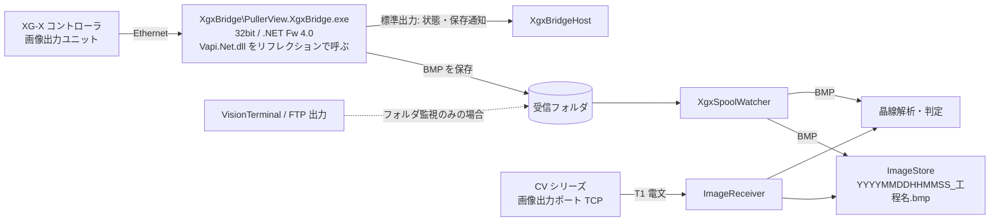

# PullerView V2 — XG-X 画像取り込み（CvImageSaver v1.4.2 からの移植）

2026-11-25。ブランチ `PullerView_V2`、版 2.0.1.0（タグ `V2-v2`）。

CvImageSaver v1.4.2 の「XG-X と Ethernet で接続して画像を取り込む機能」を PullerView V2（.NET Framework 4.0 / x86）へ移植した。
CV シリーズ（CV-5701 等。画像出力ポートへ TCP 接続）は従来どおり使え、設定で機種を切り替える。

## 1. 仕組み



- XG-X の画像は、Vapi.Net.dll（KEYENCE XG-X VisionTerminal 付属）が「受信フォルダ」へ BMP で保存する。画像データを直接受け取る API は無い。
- PullerView は受信フォルダを監視し、書込みが終わった BMP を取り込んで、保存（`[Image]` の設定）と晶線解析へ渡し、受信フォルダから削除する。
- Vapi.Net.dll は別プロセス（XgxBridge）で動かす。Vapi 内部の異常で PullerView 本体が落ちないようにするため。

## 2. 追加・変更したファイル

| ファイル | 内容 |
|---|---|
| `src/PullerView/XgxCore40.cs`（新規） | 通知形式 `XgxBridgeMessage`、設定 `XgxSettings`、受信フォルダ監視 `XgxSpoolWatcher`、ブリッジ起動・監視 `XgxBridgeHost` |
| `src/tools/XgxBridge/`（新規プロジェクト） | `PullerView.XgxBridge.exe`。ビルド後に `PullerView\bin\<構成>\XgxBridge\` へコピーされる |
| `src/tools/XgxBridge/test/FakeVapi.cs`（新規・ビルド対象外） | 試験用の模擬 Vapi.Net.dll のソース |
| `src/PullerView/VisionView.cs` | `[Camera] model`・`[Xgx]` の読み書き、XG-X 入力の開始・停止・状態表示、模擬 XG-X |
| `src/PullerView/CameraSettings.cs` | カメラ設定タブに機種の切替と XG-X の設定（日・英・中） |
| `src/PullerView/CvCore40.cs` | `ImageStore.Save` に保存時刻の指定を追加（XG-X は画像が出力された時刻をファイル名に使う） |
| `src/PullerView/Program.cs` | 診断モード `--xgx-test`／`--camera-test` |
| `config/VisionView.ini` | `[Camera] model`、`[Xgx]` を追加 |

## 3. 設定（VisionView.ini）

| キー | 既定 | 内容 |
|---|---|---|
| `[Camera] model` | `cv` | `cv`＝CV シリーズ／`xgx`＝XG-X |
| `[Xgx] mode` | `bridge` | `bridge`＝直接受信／`folder`＝フォルダ監視のみ |
| `[Xgx] ip` | `192.168.1.20` | XG-X の IP アドレス（直接受信のみ）。ポート番号の設定は無い |
| `[Xgx] spool_folder` | `XgxRecv` | 受信フォルダ（作業用。相対は EXE 基準）。**取り込んだ BMP は削除する** |
| `[Xgx] vapi_folder` | （空） | VisionTerminal のインストール先フォルダ（Vapi.Net.dll、libEGL.dll、libGLESv2.dll などがあるフォルダ） |
| `[Xgx] bridge_exe` | （空） | 空＝`XgxBridge\PullerView.XgxBridge.exe` |
| `[Xgx] stable_ms` / `scan_ms` | 1000 / 500 | 書込み完了とみなす無変化時間／確認間隔 |
| `[Xgx] detailed_log` | 0 | 1＝接続の各段階・取り込み 1 件ごとを PullerView.log に記録 |

再接続間隔は `[Camera] reconnect_sec` を共用する。設定画面では「カメラ設定」タブの左列で設定する。

受信フォルダの制限（守られていないときは監視も削除も行わない）:
- 画像保存フォルダ・再生フォルダと同じ場所、親子関係は不可。
- PullerView.exe のフォルダそのもの、その上位フォルダ、ドライブ直下は不可。
- 直接受信では、絶対パスが ANSI（その PC の文字コード。日本語 Windows は Shift_JIS）で **160 バイト以内**（全角文字は 2 バイト）。その文字コードで表せない文字を含むパスも不可。半角英数字を推奨。

受信フォルダの長さの上限について（2.0.2.0／`V2-v3` で「100 文字」から変更）:
- Vapi.Net.dll の `startLog` は受信フォルダを ANSI 文字列に変換して渡す（`Marshal.StringToHGlobalAnsi`）。
- `getSaveFilePath` は保存先のパスを **256 バイトの領域**で受け取る（`Marshal.AllocHGlobal(256)`。領域の大きさを渡す引数は無い）。保存先のパスは「受信フォルダ＋その下のフォルダ名＋ファイル名」なので、全体が 255 バイトを超えると領域をはみ出すおそれがある。
- このため上限そのものは必要。160 バイトは、受信フォルダの下の部分に 95 バイトを残す値として決めた。XG-X が実際に作るフォルダ名・ファイル名の長さは未確認のため、この値は実機の結果で見直す。
- CvImageSaver v1.4.2 の「100 文字」は文字数で数えており、全角文字が多いと 100 文字以内でも 200 バイトになる。バイト数で数えるように改めた。

## 4. CvImageSaver v1.4.2 との違い

| 項目 | CvImageSaver v1.4.2 | PullerView V2 | 理由 |
|---|---|---|---|
| ブリッジの対象 | .NET Framework 4.8 | .NET Framework 4.0 | 実機が Windows 7 32bit / .NET Framework 4.0 のため |
| Vapi.Net.dll の呼び出し | ビルド時に参照 | 実行時にリフレクション | Vapi.Net.dll は 4.7.2 向けで 4.0 のプロジェクトから参照できない。KEYENCE の著作物のためリポジトリにも置けない |
| ブリッジの配置 | exe に内蔵し、実行時に書き出す | ビルド時に `XgxBridge\` へコピー | 仕組みを単純にするため |
| OK/NG の判別（キーワード・ユニット番号） | あり | **移植していない** | 判定は晶線解析が行い、画像は 1 フォルダへ保存するため |
| 保存間隔（10 分ごとに 10 枚） | あり | **移植していない** | 保存は `[Image]` の 全数／間引き に従う。解析は全画像に行う |
| 起動前から受信フォルダにあった画像 | 取り込んで保存 | 保存するが**解析しない** | 古い画像で判定・真偽度を乱さないため |
| Vapi.Net.dll の版の確認 | なし | 起動時に使用 API 55 件の有無を確認（無ければ終了コード 6） | リフレクションのため、版の違いを最初に検出する |

呼び出す API・順序・引数、通知の形式、終了コード（2〜5、10、20〜24、30〜33、40）は v1.4.2 と同じ。
このため `bridge_exe` に `CvImageSaver.XgxBridge.exe`（v1.4.2、.NET Framework 4.8 が必要）を指定しても動く想定である（未確認）。

## 5. 確認したこと（2026-11-25、サンドボックス）

| 項目 | 結果 |
|---|---|
| .NET Framework 4.0 の参照アセンブリ・C# 5 でのコンパイル | PullerView.exe、PullerView.XgxBridge.exe とも成功 |
| 提供された Vapi.Net.dll（3.7.0.0）のメタデータと、ブリッジが使う API 55 件の照合 | 55 件すべて一致（型・メンバー名・引数の数・公開） |
| Vapi.Net.dll が参照する .NET の型・メンバーが 4.0 にあるか | 型 107 件、メンバー 195 件が解決。未解決 3 件は多次元配列（`Int32[,]`）のアクセサで、参照アセンブリに載らないもの |
| ブリッジ単体（Wine 上の 32bit、模擬 Vapi.Net.dll）の終了コード | 検出→接続→ロギング→STOP で 0／検出失敗 20／DLL 無し 4／引数誤り 2／版違い 6／XG-X 側停止 30／標準入力が閉じたとき 0 |
| 本体＋ブリッジ（Wine、模擬 Vapi.Net.dll、30 秒） | 起動→接続→12 枚を取り込み・解析。保存フォルダは最大保持枚数の 10 枚。停止でブリッジは終了コード 0 で終了し、残らない。停止の瞬間に書かれた 1 枚は受信フォルダに残り、次回の起動時に持ち越しとして保存された（解析なし） |
| ブリッジの再起動 | 検出失敗（終了コード 20）・XG-X 側の停止（30）・異常終了のいずれも、再接続間隔（5 秒）後に起動し直した。設定の誤り（DLL 無し＝4）は、14 秒の試験で起動 1 回だけ（30 秒以上空ける） |
| 模擬 XG-X（`source=sim`、20 秒） | 11 枚を取り込み・解析（模擬 XG-X は 1 ファイルを 2 回に分けて書き込む）。保存フォルダは最大保持枚数の 10 枚 |
| 受信フォルダを画像保存フォルダ／再生フォルダにした場合 | 監視せず、ファイルは 1 つも削除されなかった |
| CV シリーズ（模擬カメラ・TCP） | 従来どおり受信・保存・解析した |
| カメラ設定タブの表示（日・英・中、CV／XG-X 直接受信／フォルダ監視） | 文字の重なり・はみ出しなし |

模擬 Vapi.Net.dll は `test/FakeVapi.cs` で、型・メンバーの形を実物のメタデータに合わせたもの。実物の動作を再現するものではない。

### 2.0.2.0（`V2-v3`）で追加した確認

| 項目 | 結果 |
|---|---|
| 受信フォルダ 151 バイト（半角のみ） | 取り込み・解析できた（12 秒で 6 枚。Wine、模擬 Vapi.Net.dll） |
| 受信フォルダ 166 バイト（半角のみ） | 「受信フォルダのパスが長すぎます（現在 166 バイト、上限 160 バイト…）」を出し、ブリッジを起動しない |
| 全角を含む 122 文字のパス（日本語・中国語の文字コード） | 141 バイトと数え、検査を通過。ただしサンドボックスの Wine では全角のフォルダを作れず、取り込みまでは確認できていない |
| 同じパス（全角を表せない文字コード） | 「この PC の文字コード（ANSI）で表せない文字があります」を出し、ブリッジを起動しない |
| フォルダ選択ボタン（カメラ設定 4 欄、ログ設定 1 欄） | 日・英・中で描画を確認。ボタンを押して開く Windows の「フォルダーの参照」は、サンドボックスでは操作していない |

## 6. 確認できていないこと

1. **実機の XG-X との接続**。v1.4.2 は 2026-11-25 に実機で確認されているが、PullerView.XgxBridge（リフレクション呼び出し）では未確認。
2. **Windows 7 32bit / .NET Framework 4.0 で Vapi.Net.dll が動くか**。Vapi.Net.dll は .NET Framework 4.7.2 向けにビルドされている。参照している .NET の API は 4.0 にあることを確認したが、実行しての確認ではない。
3. **実機に必要な追加ソフト**。Vapi.Net.dll は MSVCP140.dll、VCRUNTIME140.dll、VCOMP140.dll、mfc140.dll、api-ms-win-crt-*.dll を読み込む。通常は Visual C++ 2015 以降の再頒布可能パッケージ (x86) に含まれる。XG-X VisionTerminal が Windows 7 32bit に対応しているかも未確認。
4. **Visual Studio 2022 でのビルド**。XgxBridge.csproj のビルド後コピー（`XgxBridge\` への配置）は MSBuild で試していない。
5. 画像出力ユニットが複数ある検査設定での動作（全ユニットの画像を取り込む。ユニットの選別はしない）。
6. Vapi.Net.dll の利用条件（使用許諾）。メーカーのサポート対象外の使い方である。

実機では、まず次の手順で切り分ける。

```
PullerView.exe --xgx-test 60
```

VisionView.ini の `[Xgx]` を使って取り込み〜解析だけを 60 秒動かし、状態を 1 秒ごとに表示する。`detailed_log=1` にすると、
ブリッジの「呼び出し: …」が PullerView.log に残り、どの段階で止まったかが分かる。
7. **全角文字を含む受信フォルダ**での実物の Vapi.Net.dll の動作。OneDrive などの同期フォルダの下に受信フォルダを置いた場合の動作（同期ソフトが BMP をつかんで、取り込み・削除が遅れる可能性がある）。

2・3 が成立しない場合は、(a) 実機に .NET Framework 4.8 を入れる、(b) `mode=folder` にして VisionTerminal か FTP 出力で受信フォルダへ保存させる、のどちらかになる。

## 7. 模擬 Vapi.Net.dll での試験方法（開発 PC）

```
csc /target:library /platform:x86 /out:C:\work\fakevapi\Vapi.Net.dll src\tools\XgxBridge\test\FakeVapi.cs
```

同じフォルダに空の `libEGL.dll`、`libGLESv2.dll` を置き、`[Xgx] vapi_folder` にそのフォルダを指定する。
環境変数 `FAKEVAPI_SRC`（BMP のあるフォルダ）、`FAKEVAPI_INTERVAL_MS`、`FAKEVAPI_FIND=NOT_FOUND`、`FAKEVAPI_STOP_AFTER`、`FAKEVAPI_CRASH_AFTER` で動作を変えられる。

## 8. 実機ログ（2026-11-25 17:31〜17:52）の分析と 2.0.3.0（`V2-v4`）の変更

ログに記録された環境: PC 名 Y27、`OS=Microsoft Windows NT 10.0.26100.0`、CLR 4.0.30319.42000、表示言語は中国語、PullerView は `D:\PullerView_V203\`。

### 8.1 ログで分かったこと

| 指定したフォルダ | Vapi.Net.dll | 回数 | 結果 |
|---|---|---|---|
| `D:\PullerView_V203`（および `F:\PullerView_V203`） | 無し | 9 | 終了コード 4（Vapi.Net.dll が見つからない） |
| `…\XgxBridge`（DLL 4 個をコピー） | 3.7.0.0 | 20 | 終了コード 5。「找不到指定的模块」（指定されたモジュールが見つからない）。エンジンの起動まで進んでいない |
| `C:\Program Files (x86)\KEYENCE\XG-X VisionTerminal H1X` | **3.2.0.0** | 19 | 読み込みは成功。`startUpByEngineMode` の呼び出しから 8〜23 秒後に終了コード -1073741819（0xC0000005、アクセス違反）。19 回とも同じ |

- どの回も `findControllerEther`（XG-X の検出）まで進んでいない。ブリッジから XG-X への接続は 1 度も行われていない。
- 異常終了のたびに 5 秒後に再起動していた（7 分間で 19 回）。

### 8.2 原因の判断

**DLL 4 個をコピーしたフォルダ（3.7.0.0）**
- Vapi.Net.dll 3.7.0.0 が直接必要とする DLL は、Windows 標準のものを除くと libEGL.dll、libGLESv2.dll、mfc140.dll、MSVCP140.dll、VCOMP140.DLL、VCRUNTIME140.dll（インポート表で確認）。
- libEGL.dll と libGLESv2.dll はコピーされていたので、残りの 4 つ（Visual C++ のランタイム、x86）のどれかがこの PC に無いと判断した。どれが無いかはこのログからは分からない。
- インストール先フォルダの 3.2.0.0 が読み込めているのは、そのフォルダにランタイムの DLL が同梱されているためと推定している（フォルダの内容は未確認）。

**インストール先フォルダ（3.2.0.0）**
- KEYENCE の DLL の内部（エンジンの起動中）でのアクセス違反で、原因はこのログからは特定できない。
- ブリッジがアクセス違反を検知したときの終了コード 40 にはなっていないので、エンジンが内部で作ったスレッド上で起きたと考えられる。
- ブリッジの動作を確認した版は 3.7.0.0 だけで、3.2.0.0 では 1 度も確認していない。CvImageSaver v1.4.0 で実機確認ができたときの構成は「3.7.0.0 の DLL 4 個を、書き込めるフォルダに置く」だった。今回との違いは (a) 版が 3.2.0.0、(b) 作業フォルダが Program Files（通常は書き込めない）、の 2 点。どちらが効いているかは未確認。
- VisionTerminal や CvImageSaver が同じ PC で同時に動いていたかどうかは、このログでは分からない。

### 8.3 2.0.3.0 で変えたこと

| 項目 | 内容 |
|---|---|
| 読み込めない DLL の表示 | Vapi.Net.dll を読み込めないとき、必要な DLL を 1 つずつ読み込んでみて、読み込めないものの名前を表示する（例「読み込めない DLL: mfc140.dll（Vapi.Net.dll が必要。見つかりません）」）。Visual C++ のランタイムのときは、再頒布可能パッケージ (x86) を入れるよう案内する |
| 確認だけ行う起動 | `PullerView.XgxBridge.exe --check --vapi-dir <フォルダ>`。XG-X へ接続せず、Vapi.Net.dll と必要な DLL を読み込めるかだけを調べて結果を表示する |
| 版の警告 | Vapi.Net.dll が 3.7 系でないとき「動作を確認した版は 3.7.0.0 だけです」を出す（同じ警告の繰り返しは詳細ログへ回す） |
| 異常終了時の手がかり | エンジンを起動する前に、読み込まれた DLL（名前・版・フォルダ）と、作業フォルダへ書き込めるかを詳細ログへ出す。異常終了時は直近 60 行が PullerView.log に残る |
| Windows のイベントログ | 異常終了（終了コード 0xC0000000 以上、または 40）のとき、Windows のイベントログ（アプリケーション）から「Application Error」「.NET Runtime」の記録を探し、障害が起きたモジュール名などを PullerView.log に書く（連続 1 回目と 10 回ごと） |
| 再起動の間隔 | 異常終了が 3 回続いたら、再起動を 60 秒以上空ける。状態には「異常終了しました（終了コード 0xC0000005＝アクセス違反、連続 n 回）。直前の呼び出し: …」を表示する |

### 8.4 2.0.3.0 の確認（サンドボックス）

| 項目 | 結果 |
|---|---|
| 実物の Vapi.Net.dll 3.7.0.0 と DLL 4 個だけのフォルダに `--check`（Wine） | 終了コード 5。「読み込めない DLL: mfc140.dll（Vapi.Net.dll が必要。見つかりません）」と表示（Wine には mfc140.dll が無い） |
| 模擬 Vapi.Net.dll に `--check` | 終了コード 0。読み込まれた DLL の一覧を表示 |
| エンジンの起動中に 0xC0000005 で終了する模擬（`FAKEVAPI_ENGINE_CRASH=1`、50 秒） | 起動は 3 回。3 回目のあと 60 秒待ちになり、状態に終了コード・連続回数・直前の呼び出しを表示 |
| 上のあとの通常動作、CV シリーズ | 従来どおり取り込み・解析 |
| Windows のイベントログの読み取り | **未確認**（Wine では読めず、「記録が見つかりません（または読めません）」と表示するところまで） |

### 8.5 実機で次に行うこと

1. この PC に Visual C++ 2015-2022 再頒布可能パッケージ（x86）を入れる。Vapi.Net.dll 3.7.0.0 は Visual C++ 14.44 でビルドされているので、14.44 以降が必要（Microsoft: 再頒布可能パッケージは、ビルドに使った版と同じか新しいものが必要）。インストール先フォルダ（3.2.0.0）にあるランタイムの DLL を 3.7.0.0 のフォルダへコピーする方法は、版が古い可能性があるので行わない。
2. `PullerView.XgxBridge.exe --check --vapi-dir "D:\PullerView_V203\XgxBridge"` で読み込めることを確認してから、PullerView で直接受信を試す。
3. VisionTerminal と CvImageSaver を終了した状態で試す。
4. 3.2.0.0 のフォルダで試す場合は、異常終了したときの PullerView.log（イベントログの行と「読み込み済み:」の行）を確認する。

## 9. 実機ログ（2026-11-26 17:55〜17:58）の分析と 2.0.6.0（`V2-v7`）の修正

### 9.1 ログから分かったこと（Windows 11 ビルド 26100、PullerView 2.0.4.0、`D:\PullerView_V205`）

- Vapi.Net.dll 3.7.0.0 と VC++ ランタイム（mfc140 / MSVCP140 / VCOMP140 / VCRUNTIME140、いずれも XgxBridge フォルダ）は**読み込めている**。DLL の読み込みエラー（終了コード 5）は解消した。
- `startUpByEngineMode=SUCCESS`、`findControllerEther(10000ms, 192.168.1.20)=SUCCESS` まで進む。
- その直後、コントローラ検出の結果通知で未処理の例外が発生し、ブリッジが終了コード 0xE0434352（.NET の未処理例外）で終了する。

```
System.ArgumentException: 该对象必须是运行时 Reflection 对象。（オブジェクトはランタイム Reflection オブジェクトでなければなりません）
  System.Runtime.Remoting.InternalRemotingServices.GetReflectionCachedData(MethodBase mi)
  ...
  System.Runtime.Remoting.Proxies.RemotingProxy.Invoke(...)
  Keyence.Ve.Interop.VapiCommControllerFindService.VapiCommControllerFindServiceCallbackFuncDelegate.BeginInvoke(VapiStatus status, AsyncCallback callback, Object obj)
  Keyence.Ve.Interop.VapiCommControllerFindService.callbackHandler(VapiStatus status)
```

### 9.2 原因（ブリッジ側の不具合）

Vapi.Net.dll はコールバックを `delegate.BeginInvoke`（非同期呼び出し）で呼ぶ。
ブリッジはコールバック用デリゲートを式ツリーのコンパイル（`Expression.Lambda(...).Compile()`）で作っていたが、これは DynamicMethod であり、
.NET Framework では DynamicMethod のデリゲートを `BeginInvoke` できない（上記の例外になる）。VC++ ランタイムや KEYENCE の DLL の問題ではない。

これまで見つからなかった理由: 模擬 Vapi（`test/FakeVapi.cs`）はコールバックを同期で呼んでいた。

### 9.3 修正

- `MakeDelegate`: 通常のメソッド（`CallbackSink.H1`〜`H8` を引数の型で閉じたジェネリックメソッド）に結び付けたデリゲートを作るよう変更。式ツリーは使わない。
- `test/FakeVapi.cs`: 実物と同じく `BeginInvoke` でコールバックを呼ぶ（既定）。`FAKEVAPI_SYNC=1` で従来の同期呼び出し。

### 9.4 確認（サンドボックス）と限界

- 6 種類のコールバックのデリゲートがすべて通常のメソッド（`RuntimeMethodInfo`）になり、`BeginInvoke` で呼べることを確認。
- 模擬 Vapi（`BeginInvoke` 呼び出し）で、検出 → 画像ロギング → BMP 3 枚の取り込みまで動作。
- **サンドボックスの実行環境は Mono で、Mono は DynamicMethod のデリゲートも `BeginInvoke` できるため、実機の例外そのものは再現できていない**。修正が実機で効くかは実機での確認が必要。
- 同じログの後半、Vapi.Net.dll 3.2.0.0（Program Files）指定でも同じ例外で終了している（前回の 0xC0000005 ではない）。
