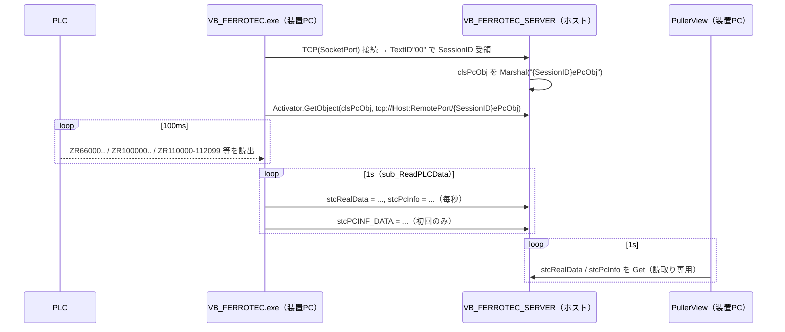

# VB_FERROTEC 3ソース一式 解析メモ（PullerView データ取得経路の確定）

- 文書ID: ANL-Source-02
- 版数: 0.2 / 最終更新: 2026-10-20（機種差なし・略称セクション名の確定を追記）
- 対象: VB_FERROTEC（クライアント／装置PC）、VB_FERROTEC_SERVER（ホスト）、VB_FERROTEC_Common_2（共通DLL）の受領ソース
- 取扱い: 社外送信禁止。本書は PullerView 要件定義書（docs/requirements.md）10.2 節の根拠
- 関連: docs/remoting-analysis.md（mdlLocalService 解析）、docs/analysis_host_frmServer.md（frmServer 解析）

## 1. 結論

1. 「Remoting Service」の実体は **VB_FERROTEC_SERVER（ホスト）**。`clsPcObj` のインスタンスはホスト側に存在し、VB_FERROTEC.exe はプロキシ経由で毎秒書き込む。
2. PullerView が毎秒読むべきは **`clsPcObj.stcRealData`（PLC 生ワード）と `clsPcObj.stcPcInfo`（工程名・長さ等の書式済み文字列）**。`stcPCINF_DATA`（名称・単位・除数）は起動時 1 回。
3. PV/SV は `stcRealData.intIOBit` から任意 index で算出できる。`stcMCValue(n).lValue` は使わない（ホスト側では初期化時の値のまま）。
4. 異常フラグの引渡しは行わない（2026-10-20 決定）。ホスト側にも受け口はない。

## 2. データの流れ



## 3. 根拠となるコード箇所

| # | 事実 | 箇所 |
| --- | --- | --- |
| S-1 | ホストが `TcpServerChannel(port=iRemotePort)` を登録 | SERVER `mdlServerService.sub_RegisterService` |
| S-2 | 装置PC接続時に `clsPcObj` を `SessionID & "ePcObj"` で Marshal | SERVER `mdlServerService.sub_Init_Pc`（`sub_Init_Server` は `eEvent` / `eServer` を Marshal） |
| S-3 | SessionID は `"PC_ID" & 連番 & ":" & 装置IP` | SERVER `frmServer.UpdateConnectPC` |
| S-4 | クライアントはプロキシ取得のみ（自身は port=0 のチャネル＝コールバック用） | CLIENT `mdlLocalService.sub_Start_Service` / `fnc_GetMarshlObject` |
| S-5 | 毎秒 `g_CurrentPcObj.stcRealData = stcRealData`、`sub_UpdatePCInf` で `stcPcInfo` 代入 | CLIENT `mdlPcObjRWPLC.sub_ReadPLCData`（`Thread.Sleep(1000)`） |
| S-6 | `stcPCINF_DATA` は `bInitFlag=False` のときだけ代入（初回のみ） | CLIENT `mdlPcObjRWPLC.sub_Init_PCINFData` |
| S-7 | `stcRealData.intIOBit` = `ZR110000〜112099`（2,100 ワード、100ms 周期で更新） | CLIENT `mdlPcObjRWPLC.sub_Update_RealTimeData` |
| S-8 | MC 値は `iPCINF(200 + n*2)`（下位）と `iPCINF(200 + n*2 + 1)`（上位）から `fnc_CalcDoubleVal` で 32bit 値、`/ lDivVal` で表示値 | CLIENT `frmMain.vb` 1338〜1356 行付近、`mdlCommon.fnc_CalcDoubleVal` |
| S-9 | `fnc_CalcDoubleVal` = 上位16bit・下位16bit を 16進連結し `Convert.ToInt32(…,16)`（符号付き32bit） | CLIENT `mdlCommon.vb` 443 行 |
| S-10 | `TP_MCINFDAT` の `iDINDEX = (Address-110200)/2`、135 項目（R110200〜R110479）。配列長は `CST_PLCINF_MAXINDEX_MCVAL`=150 | COMMON `Common.vb`、CLIENT `mdlCommon.vb` 14 行 |
| S-11 | 工程名 `strPROCESS` = `g_strAutoLogStatus`（AUTO / STATUS_CHECK / VACUUM / LEAK_CHECK / MELT / STABILIZE / NECK / CROWN / SHOULDER / BODY / TAIL / ANEEL / SHUTDOWN / MANUAL / WAITMATERIALS / MAINTENANCE） | CLIENT `mdlRecipeMgr.vb` 405〜452 行 |
| S-12 | 長さ: `str_Length`・`strINGOT_LENGTH` = index66 の表示値、`strNECK_LENGTH` = index115、`strBODY_LENGTH` = index118（`g_lblVal(iDispNo)` 経由の文字列） | CLIENT `mdlPcObjRWPLC.sub_UpdatePCInf` |
| S-13 | `Application.ini` `[Server]`: `HostIP=172.16.87.27` `SocketPort=10031` `RemotePort=10030`（開発環境サンプル） | CLIENT `bin/Debug/Application.ini` |
| S-14 | ターゲットフレームワークは .NET Framework **4.8**（Excel の「.NET 2.0」は旧記述） | COMMON / SERVER `*.vbproj` |
| S-15 | 特例: index 71 は index 109 を加算した値を表示（`'20160425 add nak`）。他にも index 132 加算の特例あり | CLIENT `frmMain.vb` 1338〜1346 行 |

## 4. PullerView 側の取得アルゴリズム（案）

```text
起動時:
  server = GetObject(clsServerObj, "tcp://{HostIP}:{RemotePort}/eServer")
  pc     = server.ConnectPc の中で IPAddress == 自PCのIP の clsPcObj   （または {SessionID}ePcObj を直接）
  mc     = pc.stcPCINF_DATA.stcMCValue          # 名称・単位・lDivVal（1回）
毎秒:
  rd  = pc.stcRealData ; info = pc.stcPcInfo
  for n in 設定された index:
      raw   = to_int32( (rd.intIOBit[200+2n+1] & 0xFFFF) << 16 | (rd.intIOBit[200+2n] & 0xFFFF) )
      value = raw / mc[n].lDivVal
  工程 = info.strPROCESS.upper()  → 対象5工程ならグラフ更新
  長さ = info.strINGOT_LENGTH（または工程別長さ）を数値化 → X 軸
```

注意: `intIOBit` の配列長が 2,100 未満（PLC 未接続時に空配列の可能性）のときは判定不能として扱う。S-15 の特例 index（71, 132 系）は VB 画面表示と差が出るため、設定時に警告する。

## 5. 補足（2026-10-20 中村氏回答）

- `Caption/FLM ini folder` の機種別定義（FT-CZ2408alpha/BZ/BZSP 等）があっても、**stcMCValue の index 割付に機種差はない**。
- DataSetting.ini のセクション名は **工程略称 + 追番**（`[NECK1]`, `[CRWN1]`, `[SHLD1]`, `[BODY1]`, `[TAIL1]`）。
- `warningcolor` / `alarmcolor` は 6桁16進 **RRGGBB**。

## 6. しないこと

- ホストの `SocketPort` / `iSocketPort_LAN` への接続（同一IPの2本目接続は電文誤配送の危険。analysis_host_frmServer.md 参照）
- `clsPcObj` の Setter・`fnc_GetRight` 等の権限取得・`stcSendPLC` の操作
- 異常フラグの送出（ADR-0009）
